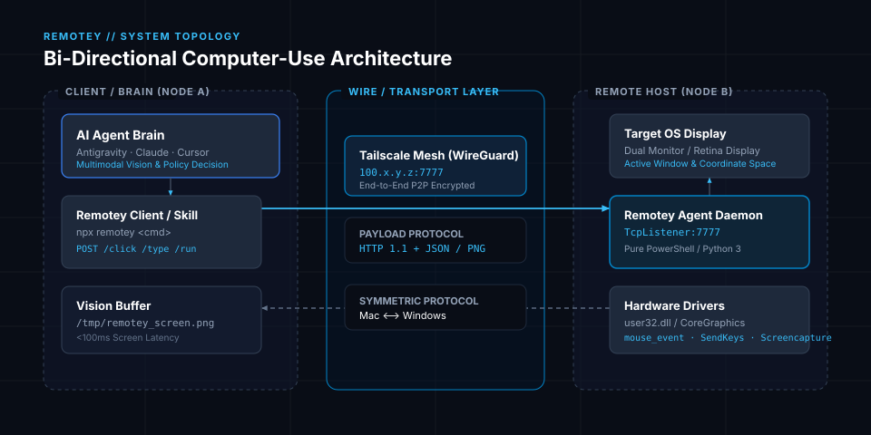

<div align="center">
  
  <p><strong>Bi-Directional Autonomous Computer-Use for AI Agents (Antigravity, Claude, Cursor) connecting Mac ⟷ Windows</strong></p>

  [](https://opensource.org/licenses/MIT)
  [](https://github.com/rpatty-dev/remotey)
  [](https://tailscale.com)
  [](agent/)
</div>

---

## What is Remotey?

**Remotey** is a bi-directional computer-use bridge for autonomous AI agents (Google Antigravity, Claude Desktop, Cursor, OpenDevin).

It allows an AI agent on **Mac to control Windows**, OR an AI agent on **Windows to control Mac**:

```
┌────────────────────────┐                               ┌────────────────────────┐
│      macOS Node        │  <══════ Tailscale ══════>    │      Windows Node      │
│  - CoreGraphics API    │      HTTP / JSON (7777)       │  - Win32 API / .NET    │
│  - Screencapture       │   Fast Vision (<100ms)        │  - Pure PowerShell     │
│  - AppleScript Keys    │   Mouse / Click / Run         │  - Real Mouse / Keys   │
└────────────────────────┘                               └────────────────────────┘
```

- **Works Both Ways**: Control a remote Windows PC from Mac, or control a remote Mac from Windows.
- **High-Speed Vision**: Captures screens in `<100ms` and pipes them directly to multimodal LLMs.
- **Native Hardware Simulation**: Direct OS-level mouse clicks, moves, right clicks, scrolls, and drag-and-drop.
- **Keyboard Simulation**: Native keystrokes, modifiers, and shortcuts (`Cmd+Space`, `Win+R`, `Ctrl+C`).
- **Zero Bloat**:
  - Windows: Pure PowerShell 5.1+ & .NET Framework.
  - macOS: Pure Python 3 & CoreGraphics. No heavy browser automation or Electron wrappers.
- **End-to-End Encrypted**: Connects over private Tailscale mesh or local LAN with zero open public ports.

---

## Quickstart

### Option A: If your Target is Windows (Control Windows from Mac)

1. Put [`START.bat`](agent/START.bat) and [`remotey_server.ps1`](agent/remotey_server.ps1) in the same folder on the Windows PC.
2. Double-click **`START.bat`** (Click **Yes** for admin to allow port 7777 in firewall).

---

### Option B: If your Target is macOS (Control Mac from Windows)

1. Run the macOS agent on your Mac:
   ```bash
   chmod +x agent/start_mac.sh
   ./agent/start_mac.sh
   ```
2. Grant Terminal / Python Accessibility permission when prompted in `System Settings -> Privacy & Security -> Accessibility`.

---

### Step 2: Connect from any AI Agent (using `npx`)

From either machine:

```bash
# Point to the remote target's Tailscale IP
export REMOTEY_TARGET="http://100.x.y.z:7777"

# Inspect state
npx remotey status

# Capture screen
npx remotey screenshot /tmp/screen.png

# Control mouse & keyboard
npx remotey click 500 300
npx remotey type "Hello World"
npx remotey hotkey "win+r"     # or "cmd+space" for Mac
```

Run interactive setup to auto-discover and register the skill in **Antigravity**, **Claude**, and **Cursor**:
```bash
npx remotey setup
```

This installs the `remotey` skill into `~/.agents/skills/remotey` and `~/.claude/skills/remotey`. Your AI agents will automatically recognize the skill and know how to autonomously inspect screens, click buttons, and operate your remote desktop.

---

## 1-Shot AI Agent Prompt (Copy & Paste)

You can install Remotey into any AI agent (Claude Code, Antigravity, Cursor, Windsurf, OpenDevin) by pasting this single prompt directly into the agent's chat:

```markdown
Install the Remotey computer-use skill from https://github.com/rpatty-dev/remotey so you can control my remote machine. 

To install:
1. Clone https://github.com/rpatty-dev/remotey.git to /tmp/remotey-install
2. Copy the skill folder /tmp/remotey-install/skills/remotey into your agent's active skills directory:
   - For Antigravity: ~/.agents/skills/remotey
   - For Claude: ~/.claude/skills/remotey
   - For Cursor: ~/.cursor/skills/remotey
3. Install the CLI binary globally or link /tmp/remotey-install/bin/remotey into /usr/local/bin/remotey
4. Test by running `remotey --help` and verify the skill is registered.
```

---

## CLI Reference

| Command | Arguments | Description |
|---|---|---|
| `remotey status` | — | Print remote screen resolution, cursor position, active window, and host info |
| `remotey screenshot` | `[path]` | Capture screenshot (default: `/tmp/remotey_screen.png`) |
| `remotey click` | `<x> <y> [btn]` | Click at coordinate (`left` or `right`) |
| `remotey dblclick` | `<x> <y>` | Double click at coordinate |
| `remotey rightclick` | `<x> <y>` | Right click at coordinate |
| `remotey move` | `<x> <y>` | Move cursor to coordinate |
| `remotey type` | `"<text>"` | Type string into focused window |
| `remotey key` | `<key>` | Send key press (`enter`, `tab`, `esc`, `backspace`) |
| `remotey hotkey` | `"<combo>"` | Send shortcut (`ctrl+c`, `alt+tab`, `win+r`) |
| `remotey scroll` | `[amount]` | Scroll wheel (`-200` down, `200` up) |
| `remotey run` | `"<powershell>"` | Execute PowerShell command directly on host and get stdout |
| `remotey set-target` | `<url>` | Persist target URL to `~/.remotey/config.json` |
| `remotey install-skill`| `[agent]` | Install skill into `antigravity`, `claude`, or `cursor` |

---

## System Architecture

<div align="center">
  
</div>

---

## Autonomous Execution Lifecycle

<div align="center">
  
</div>

---

## Security & Architecture

- **No Public Cloud Relay**: Direct peer-to-peer over WireGuard/Tailscale.
- **Firewall Guard**: Restricts listening exclusively to the specified local port.
- **Zero Windows Bloat**: Does not require Python, Node.js, C++ compilers, or registry modifications.

---

## Credits & Acknowledgements

- Created and maintained by [**rpatty-dev**](https://github.com/rpatty-dev)
- Built with help from [**nitech**](https://nitech.dev)

---

## License

MIT © [rpatty-dev](https://github.com/rpatty-dev)
